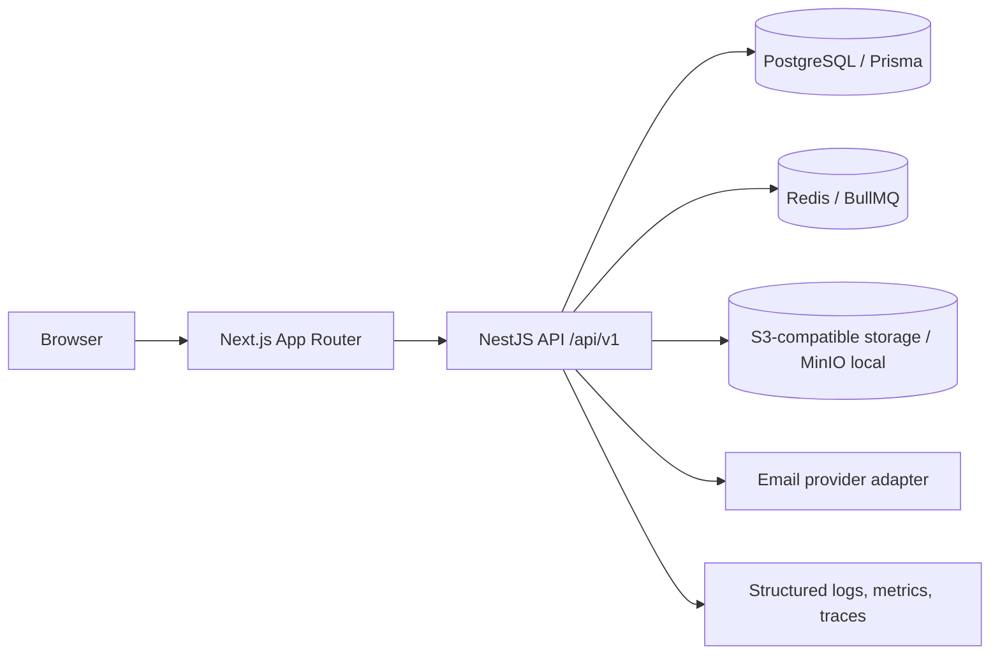

# Enterprise Corporate Portal — Architecture

## Status

Phase 0 architecture for a new repository. This document describes the target design; a feature is not considered implemented until its code, migration, authorization and tests exist.

## System shape

The initial deployment is a modular monolith. Module boundaries are explicit so a service can be extracted only when operational evidence justifies it.

## Repository boundaries

- `apps/web`: Next.js frontend, feature-oriented routes and components.
- `apps/api`: NestJS REST API, domain modules, policies and integration adapters.
- `packages/types`: shared API contracts and enums without server-only dependencies.
- `packages/ui`: shared accessible UI primitives.
- `packages/config`: shared TypeScript/lint/test configuration.
- `database`: Prisma schema, migrations and local-only seed.
- `docs`: API, database, security, deployment and runbook documentation.
- `infra`: container and deployment assets when introduced.

## Backend module boundaries

`auth`, `users`, `employees`, `organization`, `roles`, `permissions`, `cms`, `documents`, `workflows`, `approvals`, `projects`, `tasks`, `notifications`, `search`, `audit`, `settings`, `health`.

Every module owns its controller, application service, input schema/DTO, authorization policy and tests. Cross-module writes use application services and transactions rather than direct controller-to-database coupling.

## Request and security flow

1. Browser calls the web application; no browser code connects to PostgreSQL.
2. API establishes actor identity from the secure session, never from a client-supplied actor ID.
3. Authentication middleware runs before permission guards.
4. Permission checks are server-side and include object/data-scope checks.
5. DTO/schema validation runs at the trust boundary.
6. Redis applies shared fixed-window limits to login and password-reset endpoints. Failed-login counters use a hash of normalized email; authentication fails closed when Redis is unavailable.
7. Mutations use transactions where multiple records must change atomically.
8. Sensitive mutations and downloads emit audit events without secrets or raw sensitive content.
9. Background work (email, notifications, scanning) is queued and retried with bounded attempts.

## Initial data model

Identity/access: `users`, `user_profiles`, `employees`, `departments`, `positions`, `roles`, `permissions`, `user_roles`, `role_permissions`, `user_sessions`, `password_reset_tokens`.

Platform: `notifications`, `notification_recipients`, `notification_preferences`, `audit_logs`, `system_settings`.

Future bounded contexts: CMS, documents, workflows/approvals, projects/tasks and HR leave/onboarding. They must not be flattened into a shared catch-all table.

## Deployment topology

Local: PostgreSQL, Redis and MinIO via Docker Compose; web/API may run with hot reload outside Compose.

Cloud-ready target: stateless web/API containers, managed PostgreSQL, managed Redis, S3-compatible object storage, TLS termination, secret manager, centralized logs/metrics/traces and a separate migration release job. No cloud resource or paid service is created by this repository without explicit approval.

## Non-functional constraints

- UTC timestamps in storage; display in configured `Asia/Ho_Chi_Minh` timezone.
- Server-side pagination and allowlisted sorting/filtering.
- No long-lived access token in localStorage.
- No secrets in source control or container images.
- Vietnamese UI first; i18n boundary retained for English later.
- Accessibility: semantic HTML, labels, keyboard navigation and visible focus states.
