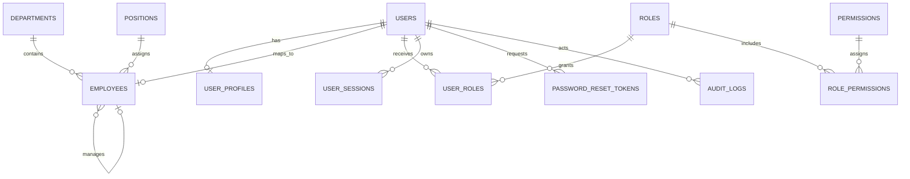

# Database Design

## Current schema

PostgreSQL is the system of record. Prisma schema is `database/schema.prisma`; committed migrations live in `database/migrations/`. IDs use PostgreSQL UUIDs. Mutable records store UTC timestamps. The initial migration creates identity, organization, RBAC, sessions, password-reset and audit tables.



### Tables and constraints

- `users`: unique email and optional unique username; password hash and account status.
- `user_profiles`: one-to-one display name, phone and avatar URL.
- `departments`, `positions`: unique codes.
- `employees`: one per user, unique employee code, optional department, position and manager; indexes on department and manager.
- `roles`, `permissions`: unique role/permission keys; many-to-many links use composite primary keys.
- `user_sessions`: unique token hash, expiry and revocation fields; index by user and expiry.
- `password_reset_tokens`: unique token hash, expiry and used timestamp; index by user and expiry.
- `audit_logs`: actor, action, resource, optional JSON metadata/IP/user agent; indexes support actor chronology and resource lookup.

CMS, documents, approvals, projects/tasks, notifications and HR-specific entities have not been added. Their schemas must arrive with the corresponding phase migration rather than being implied by this foundation schema.

## Local development commands

From the repository root, with PostgreSQL reachable at `DATABASE_URL`:

```powershell
corepack pnpm db:generate
corepack pnpm exec prisma migrate deploy --schema database/schema.prisma
corepack pnpm db:seed
```

`db:seed` loads `.env` and is allowed only with `NODE_ENV=development` or `test`. It upserts foundation permission keys, the `super_admin` role and a local administrator from `LOCAL_ADMIN_EMAIL` and `LOCAL_ADMIN_PASSWORD`, then assigns the role. The password is scrypt-hashed. The seed does not overwrite an existing user's password. The sample `admin@company.local` / `ChangeMe123!` credential is local-only; change it before sharing a development environment and never use it in staging/production.

## Migration status

`0001_init` is committed and Prisma Client generation has been verified. Applying the migration to an empty PostgreSQL database and running database integration tests remain unverified because the local Docker daemon is unavailable. Do not mark the migration gate complete until it has been applied to a disposable empty database and the resulting schema has been checked.

For production releases, run `prisma migrate deploy` as a controlled release step using the target environment's secret-injected `DATABASE_URL`. Back up the database before migrations that may alter or remove data. Never use `prisma migrate dev` against production.
